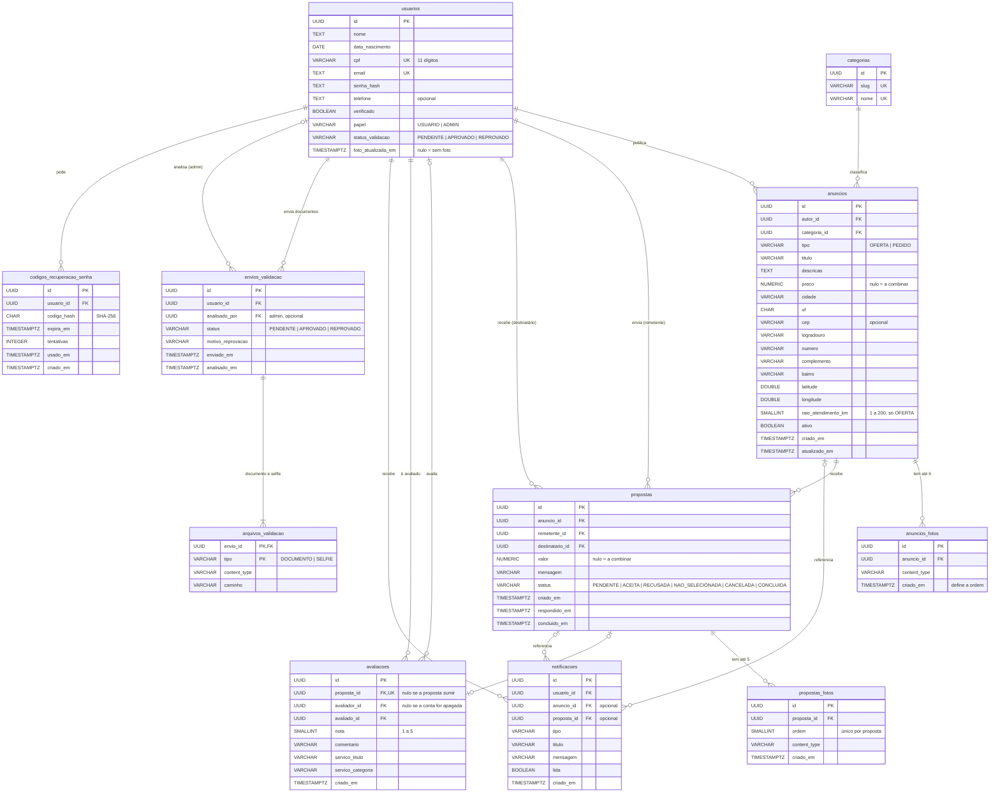

# DER do ChamaAí

Modelo entidade-relacionamento do banco (PostgreSQL), montado a partir das migrações Flyway **V1 a V14**
(`apps/backend/chamaAi/src/main/resources/db/migration`). O GitHub desenha o diagrama abaixo.

## Regras que o diagrama não mostra

| Tabela | Regra |
|---|---|
| `usuarios` | `cpf` e `email` únicos. Só `status_validacao = APROVADO` publica anúncio e envia proposta. A foto de perfil fica em disco (`uploads/perfil`); o banco guarda só `foto_atualizada_em`. |
| `anuncios` | `preco > 0` ou nulo ("a combinar"). `latitude` e `longitude` vêm juntas ou nenhuma. Excluir o usuário apaga os anúncios dele (cascade). |
| `anuncios_fotos` | Até 6 por anúncio (regra da aplicação). Arquivos em `uploads/anuncios/<anuncio>/<foto>`. Excluir o anúncio apaga as fotos. |
| `propostas` | `remetente_id <> destinatario_id`. **Uma em andamento por pessoa e anúncio**: índice único parcial em `(anuncio_id, remetente_id)` com `status IN ('PENDENTE','ACEITA')` (V14). Depois de encerrada, pode haver outra. |
| `propostas_fotos` | Até 5 por proposta; `(proposta_id, ordem)` único. Arquivos em `uploads/propostas`. |
| `avaliacoes` | Uma por proposta (`proposta_id` único), nota de 1 a 5, só depois de `CONCLUIDA`. Guarda título e categoria do serviço para continuar valendo se o anúncio for excluído. |
| `notificacoes` | `tipo`: `PROPOSTA_RECEBIDA`, `PROPOSTA_ACEITA`, `PROPOSTA_RECUSADA`, `PROPOSTA_NAO_SELECIONADA`, `VALIDACAO_APROVADA`, `VALIDACAO_REPROVADA`, `SERVICO_CONCLUIDO`, `AVALIACAO_RECEBIDA`. |
| `envios_validacao` / `arquivos_validacao` | Cada envio tem o documento e a selfie (chave composta `envio_id` + `tipo`). Arquivos em `uploads/validacao`. |
| `codigos_recuperacao_senha` | Só o hash do código é salvo; `tentativas >= 0`. |
